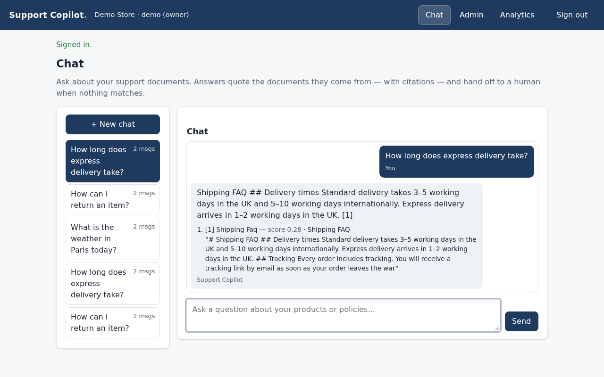
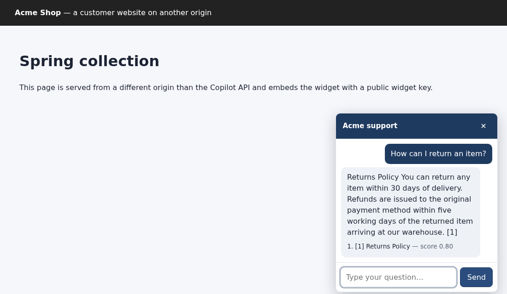

# AI Support Copilot

[](https://github.com/mr-mohamad-mr/ai-support-copilot/actions/workflows/ci.yml)

Multi-tenant AI support platform: each tenant uploads its own support
documents, and the platform answers customer questions from those documents
with citations, escalating to a human when it doesn't know. It ships with a
web app for the support team and an embeddable chat widget for the tenant's
own website.



## Features

- **Multi-tenant by construction**: every row carries `tenant_id`, taken
  from the caller's token or widget key, never from the request.
- **Cited answers, honest handoffs**: SQLite FTS5 (BM25) retrieval; the
  answer quotes the best sentences with `[n]` citations (document, chunk,
  exact character offsets, score). When nothing is relevant enough, the
  question is flagged `needs_human` instead of guessed.
- **Optional grounded LLM step**: plug in any OpenAI-compatible model
  (OpenAI, a hosted API, or a free local one such as Ollama). It only sees
  the retrieved chunks, and its reply is rejected unless every citation
  maps to one of them. Off by default.
- **Embeddable widget with a public key**: a per-tenant widget key that can
  only ask questions, a CORS origin allowlist and per-visitor rate limits.
- **Roles**: owner and admins manage the tenant; agents chat and review.
- **Analytics**: questions, handoff rate, daily series, the documents that
  actually answer questions, recent handoffs.
- Plain FastAPI + stdlib `sqlite3`, vanilla JS frontend, no build step.

## Architecture

```
┌──────────────────────────────────────────────────────────────────┐
│ FastAPI app (app/main.py), one process, one SQLite database      │
│  /auth/*            register (tenant + owner), login, me         │
│  /users             owner/admin manage admins and agents         │
│  /widget-key        public widget key + CORS origin allowlist    │
│  /documents         ingest (chunk + index on write), list, delete│
│  /chat              question → retrieval → cited answer/handoff  │
│  /conversations     stored chats: list, get, delete              │
│  /analytics/summary per-tenant usage analytics                   │
├──────────────────────────────────────────────────────────────────┤
│ app/security.py   PBKDF2 passwords + HS256 JWT (stdlib)          │
│ app/config.py     env settings; refuses the dev secret in prod   │
│ app/ratelimit.py  in-memory sliding-window limits (login, widget)│
│ app/chunking.py   recursive chunker, 1000 chars / 15% overlap,   │
│                   heading context + exact char offsets           │
│ app/retrieval.py  FTS5 candidates → tenant-level BM25, 0..1      │
│                   score, extractive answer with [n] citations    │
│ app/llm.py        optional grounded generation + citation check  │
│ app/widget.py     widget keys (hashed), origin allowlist, CORS   │
│ app/analytics.py  per-tenant usage summary                       │
│ app/database.py   schema, FTS5 index + triggers, migrations      │
│ app/static/       vanilla JS app (chat, admin, analytics) and    │
│                   widget.js                                      │
└──────────────────────────────────────────────────────────────────┘
```

## Quickstart

```bash
python3 -m venv .venv
.venv/bin/pip install -r requirements.txt
COPILOT_ENV=dev .venv/bin/uvicorn app.main:app --host 127.0.0.1 --port 8000
```

`COPILOT_ENV=dev` allows the built-in development JWT secret. Outside dev
mode the app refuses to start until `COPILOT_SECRET` is set to a real
secret.

Open <http://127.0.0.1:8000/> to sign in or create a workspace, chat, and
manage documents, the widget and conversations from Admin.

Seed demo data (tenant `Demo Store`, user `demo` / `demo-password`, four
sample documents). `--demo-chats` asks three questions so Analytics has
data; `--widget-key` creates a widget key and prints an embed snippet:

```bash
.venv/bin/python scripts/seed_demo.py --demo-chats --widget-key
```

## Configuration

| Variable | Default | Purpose |
| -------- | ------- | ------- |
| `COPILOT_SECRET` | dev-only value | JWT signing secret. **Required** unless `COPILOT_ENV=dev` |
| `COPILOT_ENV` | `production` | `dev` allows the built-in secret |
| `COPILOT_DB_PATH` | `copilot.db` next to `app/` | SQLite file |
| `COPILOT_LOGIN_RATE` | `10/300` | failed logins per client IP + username (count/seconds) |
| `COPILOT_LOGIN_IP_RATE` | `50/300` | failed logins per client IP |
| `COPILOT_REGISTER_RATE` | `10/3600` | registrations per client IP |
| `COPILOT_WIDGET_CHAT_RATE` | `20/60` | widget questions per widget key + client IP |
| `COPILOT_WIDGET_CHAT_KEY_RATE` | `600/60` | widget questions per widget key |
| `COPILOT_TRUST_PROXY` | off | take the client IP from `X-Forwarded-For` (only behind your own proxy) |
| `COPILOT_LLM_PROVIDER` | unset | `openai`, `openai-compatible`, `ollama` or `none` |
| `COPILOT_LLM_BASE_URL` / `_MODEL` / `_API_KEY` | per provider | see [LLM step](#optional-grounded-llm-step) |

Rate limits are kept in memory per process: right for the single-process
deployment shipped here; use a shared store before running several workers.

## Roles

`POST /auth/register` creates a tenant and its **owner**. The owner can add
**admins** and **agents** (`POST /users`); admins can add agents.

| | owner | admin | agent |
| - | :-: | :-: | :-: |
| Chat, read documents and conversations | ✓ | ✓ | ✓ |
| Add/delete documents, delete conversations, analytics | ✓ | ✓ | |
| Manage the widget key and allowed origins | ✓ | ✓ | |
| Add/remove agents | ✓ | ✓ | |
| Add/remove admins | ✓ | | |

Roles are read from the database on every request, so a change applies to
existing tokens immediately.

## Embeddable widget



1. As owner or admin, open **Admin → Website widget** and create a widget
   key (or `POST /widget-key`). The key is shown once; only its hash is
   stored. Rotating it disables the old key immediately.
2. Add your website's origin (e.g. `https://shop.example.com`) to the
   allowed origins (`PUT /widget-key/origins`).
3. Paste the snippet:

```html
<script src="https://YOUR-COPILOT-HOST/static/js/widget.js"
        data-api="https://YOUR-COPILOT-HOST"
        data-widget-key="wk_..."
        data-title="Need help?"></script>
```

**Security model.** The widget key is public by design (it is in your page
source), so it grants one thing: `POST /chat` for its tenant. Every other
endpoint needs a signed-in user's token. Browsers on origins outside the
allowlist are refused at the CORS preflight and on the request itself, and
`Authorization` headers are never allowed cross-origin, so a user token
cannot be used from another site. Pages served by the Copilot itself
(such as the `/widget` demo) are always allowed. Requests are rate limited
per key + client IP and per key, and a widget visitor can only continue
widget conversations. Conversations from the widget show up in Admin with
`channel: "widget"`.

## Retrieval and answers

`POST /chat` asks a question against the tenant's own documents:

1. The question is tokenized (lowercase, stopwords removed, light
   stemming so "refund" matches "refunds" and "refunded").
2. SQLite FTS5 returns candidate chunks for the tenant, ranked by `bm25()`.
   The index is updated by triggers when documents are added or deleted,
   so nothing is rebuilt per request.
3. Candidates are re-scored with BM25 using the tenant's own statistics
   and normalised to 0..1. Below `MIN_SCORE` (0.12) a chunk is not an
   answer; if nothing clears it, `needs_human` is `true`.
4. The extractive answer quotes the best sentences of each hit with `[n]`
   markers and one citation per chunk.

Existing databases are migrated on startup (search terms backfilled, index
built once).

**Latency** (`scripts/bench_chat.py`, 4 synthetic documents, 4,406 chunks,
30 questions, in-process): the old per-request TF-IDF rebuild took a median
of about 350 ms per question; FTS5 takes about 17 ms. Ingestion is slower
because it now indexes (about 1.4 s instead of 0.5 s for the 3.6 MB corpus).

**Quality gate**: `tests/eval/eval_set.json` holds 21 labelled questions
over the demo documents (18 answerable, 3 off-topic). `tests/test_eval.py`
fails if hit@1 drops below 85%, hit@3 below 95%, or any off-topic question
is answered. `python scripts/eval_retrieval.py` prints the per-question
results (currently 18/18 hit@1, 3/3 handoffs).

### Optional grounded LLM step

Off unless `COPILOT_LLM_PROVIDER` is set; without it, answers are exactly
the extractive ones above. When enabled, the model receives only the
retrieved chunks as numbered sources and must cite them as `[n]`. Its reply
is used only if it has citations, every citation points at a source it was
given, and every paragraph cites. Otherwise (or on `NO_ANSWER`, an error or
a timeout) the extractive answer is returned. Cited sources are renumbered
and only they are returned as citations; `answer_mode` in the response is
`generated` or `extractive`.

```bash
# Local and free, with Ollama (https://ollama.com):
ollama pull llama3.2
COPILOT_LLM_PROVIDER=ollama COPILOT_LLM_MODEL=llama3.2 ...

# Any OpenAI-compatible server (LM Studio, llama.cpp, vLLM, hosted APIs):
COPILOT_LLM_PROVIDER=openai-compatible \
COPILOT_LLM_BASE_URL=http://127.0.0.1:1234/v1 COPILOT_LLM_MODEL=my-model ...

# OpenAI (needs a key; without one the step stays off):
COPILOT_LLM_PROVIDER=openai COPILOT_LLM_API_KEY=sk-... COPILOT_LLM_MODEL=gpt-4o-mini ...
```

## API

| Method | Endpoint | Auth | Description |
| ------ | -------- | ---- | ----------- |
| GET | `/health` | none | liveness |
| POST | `/auth/register` | none | `{tenant_name, username, password}` → tenant + owner (rate limited) |
| POST | `/auth/login` | none | → `{access_token}` (JWT, 24 h; failed attempts rate limited) |
| GET | `/auth/me` | Bearer | current user + tenant |
| GET | `/tenants/me` | Bearer | current tenant |
| GET | `/users` | owner/admin | users of the tenant |
| POST | `/users` | owner/admin | `{username, password, role: admin\|agent}` |
| DELETE | `/users/{id}` | owner/admin | remove an agent (owner: also admins) |
| GET | `/widget-key` | owner/admin | `{configured, key_prefix, created_at, allowed_origins}` |
| POST | `/widget-key` | owner/admin | create or rotate; `{allowed_origins?}` → includes `key` (shown once) |
| PUT | `/widget-key/origins` | owner/admin | `{allowed_origins: [...]}` |
| DELETE | `/widget-key` | owner/admin | revoke |
| POST | `/documents` | owner/admin | `{title, content, source?}` → document with chunks |
| GET | `/documents?page=&page_size=` | Bearer | paginated, own tenant only |
| GET | `/documents/{id}` | Bearer | document with its chunks |
| DELETE | `/documents/{id}` | owner/admin | delete document + chunks |
| POST | `/chat` | Bearer or `X-Widget-Key` | `{question, conversation_id?, top_k?}` → `{answer, citations, needs_human, top_score, answer_mode}` |
| OPTIONS | `/chat` | none | CORS preflight for allowlisted widget origins |
| GET | `/conversations?page=&page_size=` | Bearer | paginated, own tenant only |
| GET | `/conversations/{id}` | Bearer | conversation with its messages |
| DELETE | `/conversations/{id}` | owner/admin | delete conversation + messages |
| GET | `/analytics/summary?days=` | owner/admin | usage analytics (below) |

Example:

```bash
curl -X POST http://127.0.0.1:8000/chat \
  -H "Authorization: Bearer $TOKEN" \
  -H 'Content-Type: application/json' \
  -d '{"question": "How can I return an item?"}'
# → {"answer": "…within 30 days of delivery. … [1]",
#    "citations": [{"document_title": "Returns Policy", "char_start": 0, …}],
#    "needs_human": false, "top_score": 0.80, "answer_mode": "extractive"}
```

### Analytics

`GET /analytics/summary?days=14` (`days` 1–90, default 14):

| Field | Meaning |
| ----- | ------- |
| `total_questions` / `total_conversations` | lifetime totals for this tenant |
| `answered` / `handed_off` / `handoff_rate` | assistant replies split by the `needs_human` flag |
| `avg_questions_per_conversation` | questions per conversation |
| `avg_citation_score` | mean top-citation score on answered questions (`null` when none) |
| `daily[]` | one row per day (`date`, `questions`, `answered`, `handed_off`), zero-filled |
| `top_documents[]` | the 5 most-cited documents with citation counts |
| `recent_handoffs[]` | the last 10 questions that needed a human, with conversation id |

The **Analytics** view in the app shows the same data. Headline totals
cover the tenant's whole history; `days` bounds the daily series and the
handoffs list.

## Docker

```bash
cp .env.example .env   # set a real COPILOT_SECRET
docker compose up --build
```

Then open <http://127.0.0.1:8000/>. The app runs as a non-root user in a
single container; the SQLite database lives in the named volume
`copilot-data` (mounted at `/data`), so data survives `docker compose down`.
The port is bound to localhost only and the container health-checks
`GET /health`. Seed demo data inside the stack with:

```bash
docker compose run --rm api python scripts/seed_demo.py --base-url http://api:8000 --demo-chats
```

To use a local Ollama from the container, set
`COPILOT_LLM_BASE_URL=http://host.docker.internal:11434/v1` in `.env`.

## Development

```bash
.venv/bin/pip install -r requirements-dev.txt
.venv/bin/ruff check .
.venv/bin/python -m pytest tests/ -q
```

Dependencies are pinned to exact versions (`requirements.txt` for the app,
`requirements-dev.txt` adds pytest, ruff and the test client transport).
CI runs ruff and pytest on Python 3.11 and 3.12 for every push and pull
request.

Tests use a throwaway SQLite file per test and cover chunking invariants,
auth and rate limits, roles, tenant isolation, FTS5 retrieval (ranking,
stemming, index sync on delete, migration of old databases), the widget key
(scope, rotation, CORS preflight and origin checks, rate limits), the LLM
step with fake providers (no network), the retrieval eval set, analytics,
and the frontend (served pages, no-`innerHTML` XSS guard, `node --check` on
every JS file, a full register → chat journey).

See [CHANGELOG.md](CHANGELOG.md) for changes between versions.
